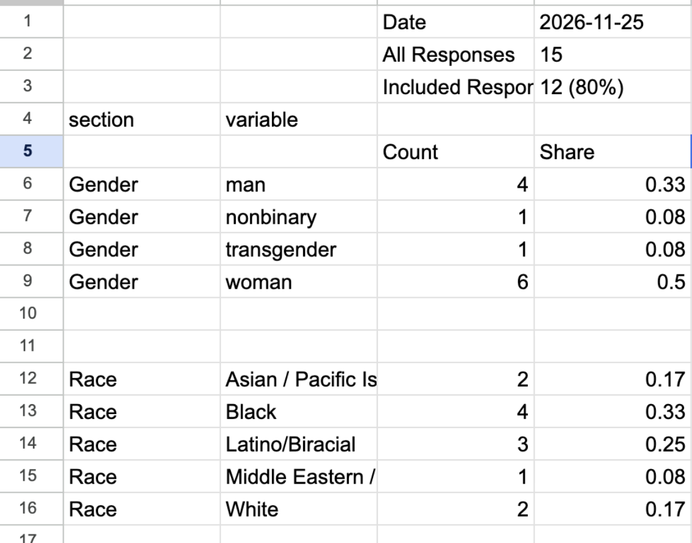
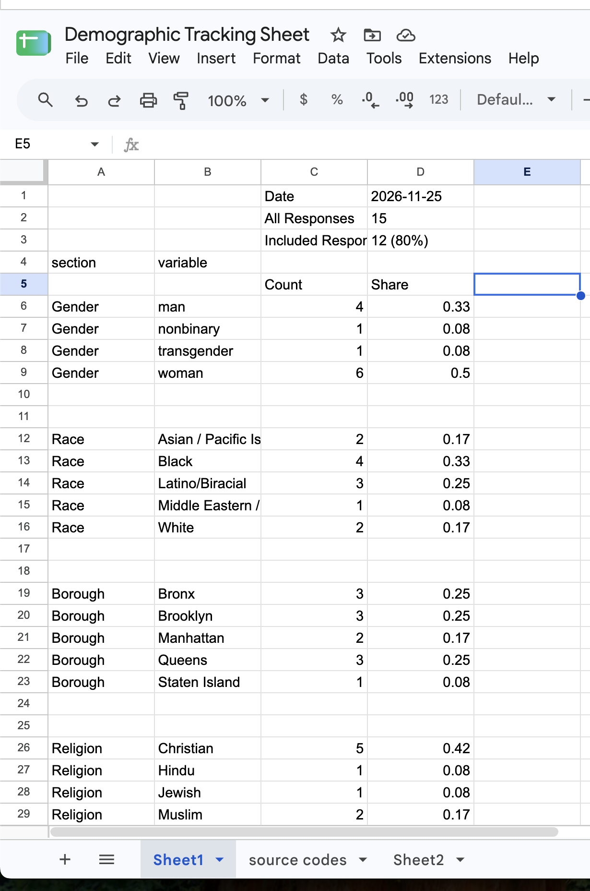
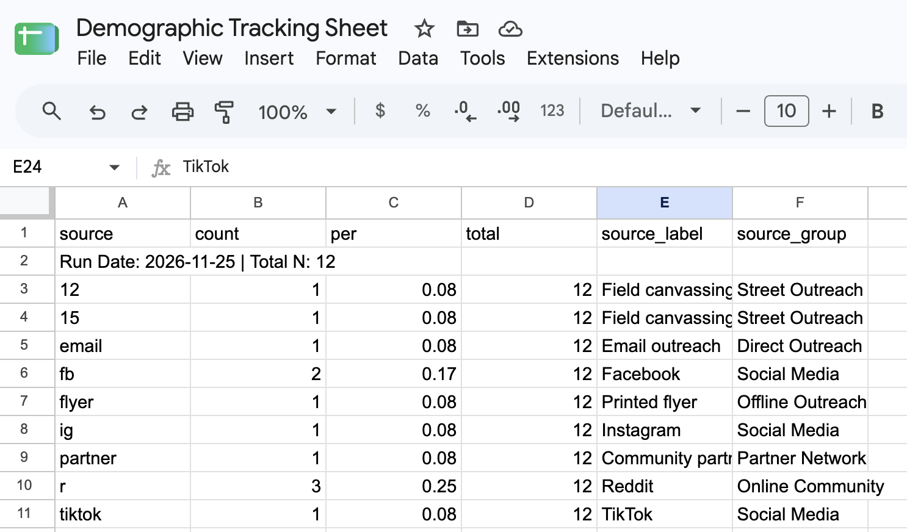

# Weekly Report Automation

An R workflow that automates recurring survey reporting, replacing manual data transfer with a reproducible pipeline for demographic summaries and stakeholder-ready outputs.

## Overview

This project grew out of a recurring reporting workflow that required manually transferring survey results from R into Google Sheets. I developed an automation workflow to reduce repetitive reporting work and make weekly updates more consistent and reproducible.

The workflow:

- processes cleaned survey outputs
- calculates recurring demographic summaries
- groups and standardizes source codes
- generates shareable reporting files
- optionally appends results directly to Google Sheets

## Why I Built It

The original reporting process involved manually copying results from R into shared spreadsheets each week. Because the same transformations and summaries were repeated across reporting cycles, the workflow was a good candidate for automation.

I translated those recurring steps into a configurable R script that could reproduce the required summaries and prepare them for stakeholder reporting.

## Workflow

1. Load cleaned survey data and configuration settings
2. Calculate recurring demographic summaries
3. Group source codes into reporting categories
4. Generate standardized output files
5. Optionally append results to a shared Google Sheet

## Portfolio Version

The original workflow was developed within a larger internal survey-analysis repository using private organizational data.

This public version preserves the automation logic while removing private IDs, organization-specific naming, credentials, and machine-specific configuration. Synthetic demo data matching the required input structure is included so the workflow can be run end-to-end.


## Example Output

Google Sheets output using the portfolio version's synthetic demo data.

### Report preview



### Demographic summaries



### Source codes



## Files

- `report_automation_portfolio.R` — main automation workflow
- `reporting_automation_original_demo.Rmd` — original reporting notebook adapted to run with synthetic data
- `write_demographics_run.R` — shared Google Sheets layout for the notebook and script
- `config/report_config_template.yml` — configuration template
- `data/demo/` — synthetic example inputs
- `output/` — example generated outputs
- `.gitignore` — excludes credentials, local configuration, and generated artifacts

## How to Run

Install the demo dependencies once in R.

```r
install.packages(c("dplyr", "readr", "stringr", "gtools", "yaml", "rmarkdown", "knitr"))
```

**Original reporting notebook.** Open [reporting_automation_original_demo.Rmd](reporting_automation_original_demo.Rmd) in RStudio and click **Knit**. The notebook builds an HTML report and writes three CSVs to `output/original-demo/`. It recreates the original cleaning objects from synthetic inputs for the response counts.

**Standalone script.** From the downloaded project folder, run `Rscript report_automation_portfolio.R`. The script uses the bundled demo configuration and writes three CSVs to `output/`.

## Optional Google Sheets Integration

Use the [public demo spreadsheet](https://docs.google.com/spreadsheets/d/1ZMKmJ8zttxe1u7TiJZea9dECFLtKiGsBZVCc_Nrimt0/edit?gid=50620692#gid=50620692) to see the layout. To test the upload, [make your own copy](https://docs.google.com/spreadsheets/d/1ZMKmJ8zttxe1u7TiJZea9dECFLtKiGsBZVCc_Nrimt0/copy) while signed in to Google.

1. In your copy, create any missing tabs named `Sheet1` and `source codes`. If `Sheet1` already has a different layout, rename that tab and add a blank `Sheet1` for the test.
2. Install `googlesheets4` with `install.packages("googlesheets4")`.
3. Copy the spreadsheet ID from your copy's URL. It's the text between `/d/` and `/edit`.
4. For the notebook, enter that ID in Setup. For the standalone script, copy the config template to `config/report_config.yml`, enter the ID, and set `use_google_sheets: true`.
5. Run the notebook or script and authenticate with Google when prompted.

On a blank `Sheet1`, the report writes section and category labels in columns A and B and the first run in C and D. Later runs add count and share columns to the right after checking that the category labels still match. Recruitment summaries append down the `source codes` tab.

## Tools

- R
- tidyverse
- YAML
- googlesheets4
